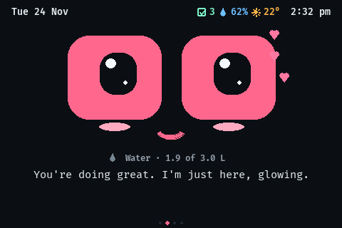
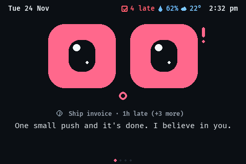
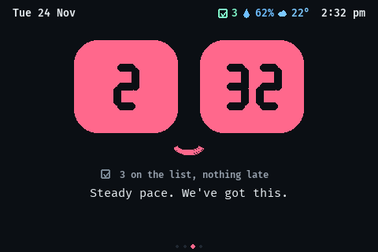
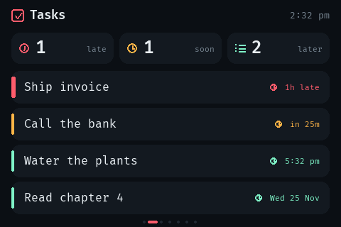
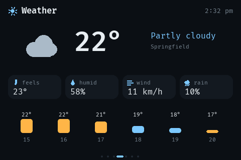
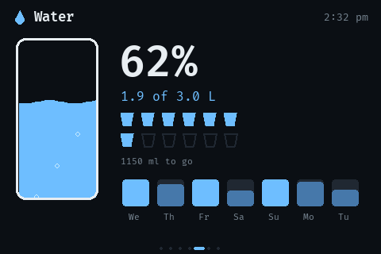
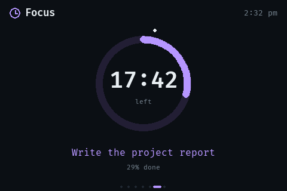
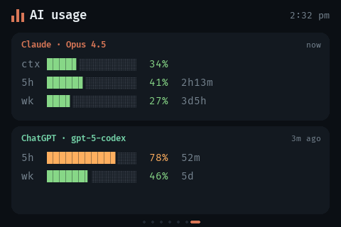
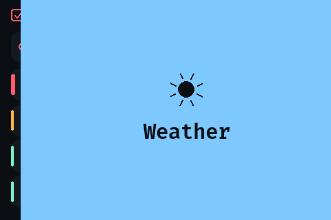

<div align="center">

# JIRI

**A small pet that lives on your desk, keeps an eye on your day, and tells you why it feels the way it does.**



[](https://github.com/4riful/jiri/actions/workflows/ci.yml)
[](LICENSE)

</div>

JIRI runs on a Raspberry Pi 3B/3B+ with a 3.5" touchscreen. It has a face,
a mood that comes from real things (your tasks, your water, the weather), and
a few info screens you can flip through with a tap. You manage everything from
a web dashboard on your home network.

We built it around one rule: **nothing on the screen moves without a reason.**
JIRI never tells you how it feels in words; you read it in its face, and the
thought under its eyes shows what it's looking at.

## What it does

- **A face that feels things.** An emotion engine (valence and arousal)
  appraises your late tasks, upcoming deadlines, water, focus, weather and AI
  usage, and settles on one feeling. The face shows it (eyes, lids, pupils,
  mouth, blush); it is never written on screen as a label.
- **A pet brain.** Poke it, tickle it, ignore it. It yawns when tired, falls
  asleep, wakes up startled and then pleased, and gets a bit grumpy if you poke
  it too much. Tap the top bar and its eyes turn into the clock.
- **Thoughts.** On Home, JIRI cycles through facts it has an opinion about.
  Each one is a real fact computed in Python plus a short quip written by a
  hosted LLM, decoded onto the screen with a scramble effect.
- **Info screens.** Tasks, Notes, Weather, Water, Focus and AI usage (Claude
  and ChatGPT 5-hour and weekly limits).
- **An admin dashboard** on your LAN (port 5000) for todos, notes, water,
  focus, weather, the AI voice, usage sources and Telegram.
- **A live preview** of the display in your browser, which you can tap just
  like the real panel.
- **Works offline.** Weather falls back to its cache, the AI voice to cached
  and built-in lines. The face never waits on the network.

## Screenshots

These are rendered headless by JIRI's own renderer, pixel for pixel what the
480x320 panel shows.

| | | |
|:-:|:-:|:-:|
| <br>Home, happy | <br>Home, worried | <br>Time check |
| <br>Tasks | <br>Weather | <br>Water |
| <br>Focus | <br>AI usage | <br>Screen change |

All of them on one sheet: [docs/images/contact-sheet.png](docs/images/contact-sheet.png).

## Hardware

| Part | Notes |
|---|---|
| Raspberry Pi 3B or 3B+ | 1 GB RAM is plenty. No model runs on the Pi. |
| 3.5" 480x320 SPI touchscreen | The common GPIO-header panel (ILI9486 controller, ADS7846 touch). |
| microSD card | A decent one; JIRI keeps SD writes to a minimum. |
| 5 V 2.5 A power supply | Under-voltage shows up in `vcgencmd get_throttled`. |

**Display.** What works on our panel (Raspberry Pi OS / Debian 13, 64-bit) is
the old fbtft driver, not the DRM one. In `/boot/firmware/config.txt`:

```ini
dtparam=spi=on
dtoverlay=piscreen,speed=16000000,rotate=90
```

Don't add `drm` to that overlay: `piscreen,drm` gave us a plain white screen.
This loads `fb_ili9486` as a native 480x320 landscape framebuffer. It may show
up as `fb0` or `fb1` depending on the boot; JIRI finds the panel by name.
To keep the boot console off the panel, append `fbcon=map:9` to
`/boot/firmware/cmdline.txt`. Back up both files first.

**Touch.** The ADS7846 controller sits on `spi0.1`. Its reported ranges are
rarely right, so you can calibrate with
`JIRI_TOUCH_CAL="xmin,xmax,ymin,ymax[,swap]"` in `.env`. On our unit the driver
binds but the interrupt line stays low, so touch is still unconfirmed on real
hardware; the browser preview's tap works in the meantime.

The full checklist, with what's confirmed and what isn't, is in
[docs/PI_DISPLAY_CHECKLIST.md](docs/PI_DISPLAY_CHECKLIST.md).

## Quick start

### Try it on your laptop (Linux, WSL, macOS)

You don't need a Pi to play with JIRI.

```bash
git clone https://github.com/4riful/jiri.git
cd jiri
python3 -m venv .venv
.venv/bin/python -m pip install -r requirements-dev.txt
echo 'JIRI_ADMIN_PASSWORD="pick-something"' >> .env   # no default; logins are refused without it

PYTHONPATH=src .venv/bin/python -m jiri.cli init-db
PYTHONPATH=src .venv/bin/python scripts/seed_demo.py   # optional: demo tasks, notes, water, focus

scripts/run_all.sh
```

Then open:

- <http://127.0.0.1:5001/screen>, the live display (click to tap it)
- <http://127.0.0.1:5000/admin>, the dashboard

Want the real pygame window instead? In another terminal (WSLg works):

```bash
scripts/run_ui.sh
```

### Install on the Pi

Set up the display first (see [Hardware](#hardware)), then from the repo root:

```bash
git clone https://github.com/4riful/jiri.git ~/jiri && cd ~/jiri
scripts/install_pi.sh               # apt packages, venv, database, .env with a generated admin password
nano .env                           # fill in FREELLM_BASE_URL and FREELLM_API_KEY (or another provider)
scripts/create_systemd_services.sh  # installs and starts jiri-web and jiri-ui
```

`install_pi.sh` prints the admin password once; it's also in `.env`. The
dashboard is then at `http://<pi-address>:5000/admin`. Use
`scripts/create_systemd_services.sh --dry-run` to see the units before
installing them, and `scripts/pi_smoke_test.sh` to check the install. More in
[docs/PI_DEPLOYMENT.md](docs/PI_DEPLOYMENT.md).

## Using it

### Touch

| Where | Tap | What happens |
|---|---|---|
| Home, on the face | single | Pet JIRI: poke, tickle (fast taps), wake it up |
| Home, top bar | single | Time check: the eyes show the clock for a few seconds |
| Home, below the face | single | Next screen, with a splash |
| Any info screen | single | Next screen, with a splash |
| Anywhere | double | Turn automatic screen rotation on or off |

Screens change on their own by default, with the same splash wipe as a tap:
Home holds for 45 seconds, each info screen for 15. Double tap to stop on the
current screen (and again to resume). If you stop on an info screen and leave
it, JIRI wanders back to Home after a minute. An urgent mood change also pulls it
back home.

### The dashboard

| Page | For |
|---|---|
| `/admin` | Overview |
| `/admin/todos`, `/admin/notes` | Tasks and notes |
| `/admin/water`, `/admin/focus` | Water goal and log; focus sessions |
| `/admin/weather` | Location search, providers, refresh |
| `/admin/persona` | Quiet hours and nudges |
| `/admin/ai` | AI voice: providers, cache, recent activity |
| `/admin/usage` | AI usage sources: push token, Pi sign-in, what shows |
| `/admin/telegram` | Bot token, allowed chats |
| `/screen` | Live preview of the display |

There's also an SSH-friendly CLI: `PYTHONPATH=src .venv/bin/python -m jiri.cli --help`.

## The AI voice

JIRI's quips and reactions are written by a hosted LLM, but never while the
screen is drawing.

- A background worker in the web process asks the providers for new lines
  every 10 minutes (`ai.refill_interval_minutes`) and stores them in SQLite.
- The display only reads that cache. No network call ever happens in the draw
  loop.
- Providers are tried in order: FreeLLMAPI, then Gemini, then Groq. Any
  OpenAI-compatible endpoint works, including Ollama on another machine. See
  the `[ai]` section of [config.example.toml](config.example.toml).
- With no provider reachable, JIRI uses cached lines, then hand-written
  fallbacks. It keeps talking.
- **No personal data is sent.** A request carries a category, a mood and style
  instructions. Never your task titles, notes or location; those get filled in
  on the device.
- The AI only chooses words. It can't change your todos, timers, weather or
  anything else.

You can watch what it's doing at `/admin/ai`. The design and its rules are in
[docs/AI_SPEC.md](docs/AI_SPEC.md); why there's no model on the Pi is in
[docs/AI_STRATEGY.md](docs/AI_STRATEGY.md).

## AI usage on the display

The AI usage screen shows Claude and ChatGPT 5-hour and weekly limits. There
are two ways to feed it. Use either or both; the newest report wins.

**Push from your laptop.** On `/admin/usage`, generate a token. The page then
shows ready-to-copy commands with the Pi's address filled in:

- *Claude Code:* wrap your statusline with
  `scripts/jiri_usage_push.py claude-statusline --then '<your old command>'`.
  It pushes at most once a minute in the background.
- *ChatGPT:* sign in once with OpenAI's `codex` CLI (`codex login --device-auth`).
  `jiri_usage_push.py codex-live` then asks codex for your plan limits, the same
  "5-hour limit / Weekly limit" numbers the Codex app shows. Codex keeps its own
  login, so JIRI never sees a token. The Claude statusline wrapper runs it every
  5 minutes. (Alternatives: the OpenCode plugin in `integrations/opencode/`, or
  `jiri_usage_push.py codex` for old Codex session logs.)

**Sign in from the Pi.** On the same page, click **Connect**, sign in, and
paste the code back. The Pi then checks usage itself every 5 minutes. It's a
separate session, so it doesn't log out your laptop tools.

## Configuration

Copy `config.example.toml` to `config.toml` for display, weather, focus, AI
and Telegram settings. Secrets and overrides go in `.env` in the project root
(never committed); both services read it.

| Variable | What it does |
|---|---|
| `JIRI_ADMIN_PASSWORD` | Dashboard password. Required, no default. |
| `JIRI_WEB_SECRET_KEY` | Session key; generated and stored if unset |
| `FREELLM_BASE_URL`, `FREELLM_API_KEY`, `FREELLM_MODEL` | First AI provider (FreeLLMAPI) |
| `GEMINI_API_KEY`, `GROQ_API_KEY` | Fallback AI providers |
| `JIRI_AI_DAILY_CAP` | Most AI requests per day (default 200) |
| `JIRI_USAGE_TOKEN` | Legacy usage-push token (the `/admin/usage` token is preferred) |
| `JIRI_DISPLAY_OUTPUT` | `sdl` (window, default) or `fb` (the SPI panel) |
| `JIRI_FB_DEVICE`, `JIRI_FB_ROTATE` | Framebuffer override; rotation for a portrait framebuffer (`90`/`270`) |
| `JIRI_TOUCH_DEVICE`, `JIRI_TOUCH_CAL` | Touch device override; calibration `xmin,xmax,ymin,ymax[,swap]` |
| `JIRI_ROTATE` | `0` to start with automatic screen rotation off (default on) |
| `JIRI_CLOCK_24H` | `1` for a 24-hour clock |
| `JIRI_DB_PATH`, `JIRI_CONFIG`, `JIRI_ENV_FILE` | Paths to the database, config and `.env` |
| `JIRI_WEB_HOST`, `JIRI_WEB_PORT`, `JIRI_WEB_SURFACE` | Web bind address and what it serves (`all`, `admin`, `screen`) |
| `JIRI_WEATHER_LOCATION` | Weather location override |
| `JIRI_TELEGRAM_BOT_TOKEN`, `JIRI_TELEGRAM_ALLOWED_CHAT_IDS` | Seed Telegram on first boot; manage it from `/admin/telegram` after |

AI keys also accept a `JIRI_` prefix (`JIRI_GEMINI_API_KEY`).

## Project layout

```text
src/jiri/
  runtime.py, db.py, todos.py, ...  the core: every fact and every write
  ai.py, ai_worker.py, quips.py     the AI voice, its worker and fallbacks
  usage.py, usage_accounts.py       AI usage pushes and Pi sign-in
  ui/                               the display: stage, pet, emotion, pages, mascot, output
  web/                              Flask admin and the /screen preview
scripts/                            run, install, backup, preview and benchmark scripts
integrations/opencode/jiri-usage/   OpenCode plugin for ChatGPT limits
systemd/                            jiri-web and jiri-ui units
tests/                              pytest suite
docs/                               design, status and Pi notes
```

## Development

```bash
.venv/bin/python -m pytest -q                                      # the test suite
scripts/test_wsl.sh                                                # full gate: tests, CLI walkthrough, headless display
PYTHONPATH=src .venv/bin/python scripts/render_preview.py preview/ # every mood to PNG, plus a sheet
PYTHONPATH=src .venv/bin/python scripts/bench_display.py           # frame cost and an estimate for the Pi
```

Rules for contributors live in [AGENTS.md](AGENTS.md) and
[CONTRIBUTING.md](CONTRIBUTING.md). The short version: keep it light enough
for a Pi 3, keep the network out of the draw loop, and never let the AI touch
state.

## Docs

- [ENGINEERING_HANDBOOK.md](docs/ENGINEERING_HANDBOOK.md): rules, behaviour and stage gates (the source of truth)
- [ARCHITECTURE.md](docs/ARCHITECTURE.md): processes, data flow, where writes happen
- [STATUS.md](docs/STATUS.md): what has passed and what still needs the Pi
- [PI_DISPLAY_CHECKLIST.md](docs/PI_DISPLAY_CHECKLIST.md): panel, framebuffer and touch
- [PI_DEPLOYMENT.md](docs/PI_DEPLOYMENT.md), [HARDWARE.md](docs/HARDWARE.md), [TROUBLESHOOTING.md](docs/TROUBLESHOOTING.md)
- [AI_SPEC.md](docs/AI_SPEC.md), [AI_STRATEGY.md](docs/AI_STRATEGY.md)
- [PERFORMANCE_BUDGETS.md](docs/PERFORMANCE_BUDGETS.md), [WSL_DEVELOPMENT.md](docs/WSL_DEVELOPMENT.md), [SAFE_UPDATE_METHODOLOGY.md](docs/SAFE_UPDATE_METHODOLOGY.md)

## License

MIT. See [LICENSE](LICENSE).
